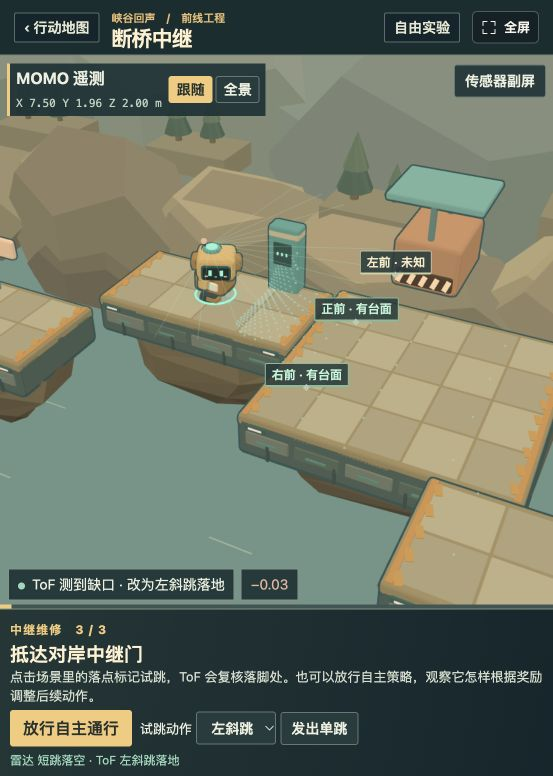

# 峡谷回声 · 机器人工坊

游戏大厅 · A* 山路救援 · MOMO 断桥中继

## 部署方式

作品已私有部署，比赛现场由团队账号登录投屏。

## 演示视频

约 33 秒，含中文字幕，展示山路规划、算法复盘、机械臂换装，以及 MOMO 接入深度传感器前后的两次试跳。

[下载演示视频（MP4）](docs/demo.mp4)

## 页面截图

### 三维驾驶场景

### A* 与 Dijkstra 搜索复盘

### 机械臂更换电芯

### MOMO 断桥试跳

