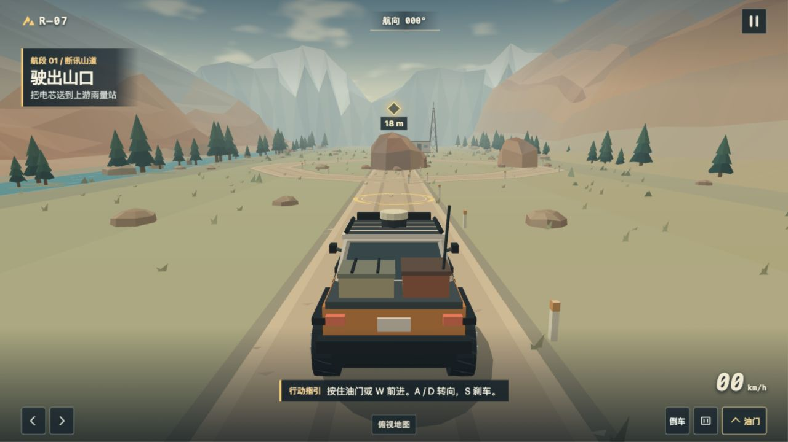
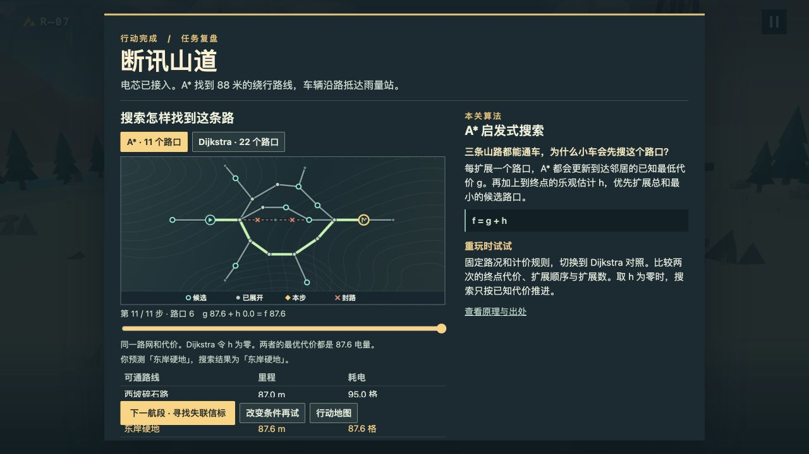
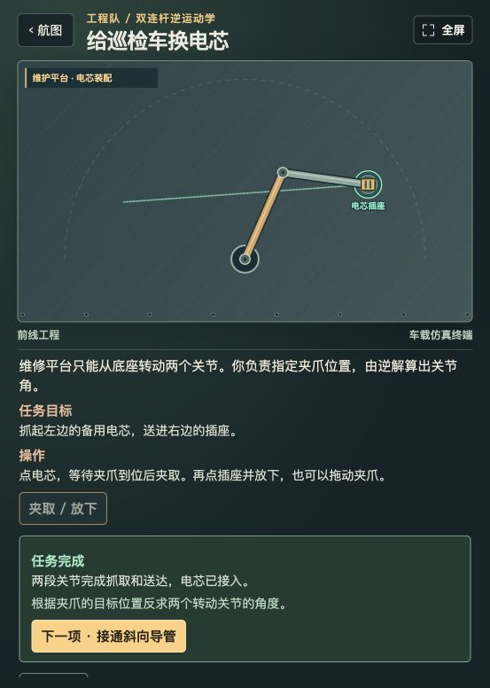

<h1 align="center">峡谷回声 · 机器人工坊</h1>

<p align="center">
  <strong>把算法学习变成一场可交互的峡谷救援</strong><br>
  游戏大厅 · A* 山路救援 · MOMO 断桥中继
</p>

<p align="center">
  
  
  
  
  
</p>

<p align="center">
  <a href="#项目亮点">项目亮点</a> ·
  <a href="#游戏内容">游戏内容</a> ·
  <a href="#快速开始">快速开始</a> ·
  <a href="#演示视频">演示视频</a> ·
  <a href="#项目结构">项目结构</a>
</p>

<p align="center">
  
</p>

## 项目简介

**峡谷回声**是一套以机器人救援为主线的交互式算法教学游戏。玩家需要扫描受阻道路、比较搜索算法、驾驶探测车、完成机械臂换装，并帮助 MOMO 识别安全落点。

不只展示公式和动画：每一次传感器选择、路径调整与控制输入，都会直接影响任务结果。通关后还可以通过算法复盘，回看关键决策与执行过程。

## 项目亮点

| 任务驱动学习 | 可视化算法复盘 |
| --- | --- |
| 沿着峡谷救援主线完成传感器装配、路径规划、自动驾驶与电芯运送，在真实任务语境中理解算法。 | 对照 A* 与 Dijkstra 的搜索过程，观察 D* Lite 的增量重规划和 RRT* 的邻域重连。 |
| **多机器人实操**<br>覆盖探测车、机械臂、飞行器与双足机器人，连接规划、感知、控制和步态等知识。 | **MOMO 深度感知实验**<br>对比开关 ToF 深度传感器后的试跳结果，调整奖励函数与 Q 学习参数并观察策略变化。 |

## 游戏内容

| 模块 | 玩法与知识点 |
| --- | --- |
| 峡谷回声主线 | 雾线山道、落石隘口、回声深谷三段任务；纯追踪、动态窗口避障与卡尔曼融合。 |
| A* 山路救援 | 扫描道路、搜索救援路线，并通过回放比较 A* 与 Dijkstra 的扩展顺序和路径代价。 |
| 前线工程任务 | Dijkstra 最小代价路径、D* Lite 增量重规划、RRT* 路径优化，以及机械臂、无人机和双足机器人实操。 |
| MOMO 断桥中继 | ToF 落点检测、深度点云与 Q 学习；支持任务模式、单步对照和自由训练实验。 |
| 算法群岛 | 定位观测、地图测绘、同步建图、路径规划、轨迹跟踪、机械臂、空中导航与双足步态八大主题。 |

## 快速开始

项目使用原生 HTML、CSS 和 JavaScript，**无需安装依赖，也无需构建**。

```bash
git clone https://github.com/huvh/trae_match.git
cd trae_match
python3 -m http.server 8080
```

浏览器打开 [http://localhost:8080](http://localhost:8080)。

建议使用本地 HTTP 服务运行，以确保 MOMO 的 ES Module、内嵌页面和媒体资源正常加载。游戏进度保存在当前浏览器中。

## 演示视频

约 33 秒，含中文字幕，展示山路规划、算法复盘、机械臂换装，以及 MOMO 接入深度传感器前后的两次试跳。

**[下载演示视频（MP4）](docs/demo.mp4)**

## 更多画面

| A* 与 Dijkstra 搜索复盘 | 机械臂更换电芯 | MOMO 断桥试跳 |
| --- | --- | --- |
|  |  |  |

## 项目结构

```text
.
├── index.html              # 游戏主入口与脚本加载顺序
├── momo-stage.html         # MOMO 独立任务舞台
├── app.js                  # 游戏大厅、算法群岛与页面路由
├── campaign.js             # 峡谷回声三段主线
├── field-*.js              # 感知、规划、驾驶与机器人任务
├── canyon-*.js             # 三维峡谷、驾驶场景与任务界面
├── momo-*.js / *.mjs       # MOMO 任务、场景与运行逻辑
├── art/                    # 场景美术资源
├── media/                  # 算法演示媒体及素材许可
├── vendor/                 # 本地第三方依赖与许可
└── docs/                   # README 演示视频与页面截图
```

根目录脚本由页面直接加载，不依赖 `src/`、`dist/` 或包管理器。`index.html` 可直接作为静态站点入口，适合部署到常规静态 Web 服务。

## 技术栈

- **界面与交互：** HTML5、CSS3、原生 JavaScript
- **场景与可视化：** Canvas、WebGL、Three.js
- **模块与数据：** ES Modules、Hash 路由、localStorage
- **运行方式：** 纯静态资源，本地依赖，无需后端

## 第三方资源

- Three.js 许可：[vendor/three/LICENSE](vendor/three/LICENSE)
- PythonRobotics 演示素材许可：[media/LICENSE.txt](media/LICENSE.txt)
